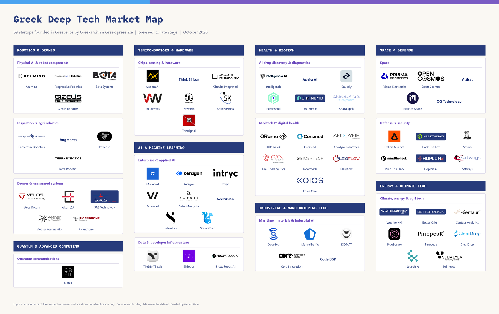

# Greek Deep Tech Market Map

[](map/greek_deeptech_market_map.pdf)

A research dataset, a one-page market map, a short analysis and a 2027 investment thesis for the Greek deep tech ecosystem.

Author: Gerald Velas. Data as of 16 October 2026.

## What is in this repo

| Deliverable | File |
|---|---|
| Research dataset (88 companies screened, 69 mapped) | [data/greek_deeptech_dataset.csv](data/greek_deeptech_dataset.csv) |
| Market map with logos (PNG, PDF) | [map/greek_deeptech_market_map.png](map/greek_deeptech_market_map.png), [PDF](map/greek_deeptech_market_map.pdf) |
| Analysis (3 pages) | [reports/greek_deeptech_analysis.pdf](reports/greek_deeptech_analysis.pdf) |
| Thesis: where I would invest in 2027 (1 page) | [reports/greek_deeptech_thesis_2027.pdf](reports/greek_deeptech_thesis_2027.pdf) |
| Open research items | [data/research_queue.md](data/research_queue.md) |

## Scope

"Greek deep tech" means companies founded in Greece, or founded by Greeks with a meaningful Greek presence (a Greek office, team, or Greek-led leadership). Stages run from pre-seed to Series B, with a few later-stage and exited companies shown for context.

Categories: Robotics & Drones, AI & Machine Learning, Semiconductors & Hardware, Energy & Climate Tech, Health & Biotech, Space & Defense, Quantum & Advanced Computing, Industrial & Manufacturing Tech.

## Dataset

One row per company. Columns:

`company_id`, `company`, `category`, `sub_sector`, `what_they_do`, `founded`, `hq_greek_link`, `stage`, `last_round_amount`, `last_round_date`, `investors`, `website`, `source_link`, `map_status`, `verification_status`, `notes`, `last_verified`, `github_org`, `linkedin_url`

- `source_link`: one or more URLs, separated by ` | `. Every row has at least one.
- `map_status`:
  - **Include**: Greek link and company details verified.
  - **Borderline**: shown on the map, but the Greek link or the deep tech fit is not fully confirmed.
  - **Hold**: not on the map; a Greek link or source could not be found after two searches.
  - **Exclude**: checked and removed (not Greek, or not deep tech). Kept so the decision is on record.
- `UNVERIFIED` and `Not found` mark data I could not confirm. Funding numbers are never estimated.
- Amounts keep the currency of the source. Where sources disagree, the `notes` and `verification_status` columns say so.
- `github_org` and `linkedin_url` are empty on purpose, reserved for the deal-flow tracker (phase 2).

Current counts: 36 Include, 33 Borderline, 2 Hold, 17 Exclude.

## Verification

`data/verification_report.csv` checks every source link automatically (company name, amount and lead investor must appear on the cited page). 64 of 69 mapped companies pass; the rest were checked by hand or are flagged. See [data/verification_notes.md](data/verification_notes.md) for what the check does and does not prove, and for the known gaps (founding year missing for 1 of 69, websites complete).

## Method

1. Verified the nine starting companies one by one (website, news, funding, Greek link).
2. Swept investor portfolios and news lists: Big Pi Ventures, Marathon VC, Metavallon VC, Evercurious VC, Genesis Ventures (its portfolio page), The Recursive, Athens Tech Circle, EU-Startups and the ESA BIC Greece incubator (read in a browser), Elevate Greece registry, company sites, and aggregators (CB Insights, Seedtable, Caplight) where nothing better existed.
3. Repeated passes on companies with a missing Greek link or source, until each was resolved or documented as unresolved.

Limits:

- The sample was seeded from investor portfolios, so investor counts in the analysis reflect overlap with those portfolios, not market share.
- Sifted's 2022 deeptech list is paywalled and unreadable, and Tracxn and the full Big Pi and Marathon portfolio pages could not be read, so companies that appear only there may be missing.
- Quantum has no verified venture-backed Greek company, and that is a finding, not a gap in effort.

## Map design

Off-white background, purple `#7a5cc4`, blue `#4aa3f0`, navy `#273B7B`, Red Hat Mono titles (SIL Open Font License, see `fonts/OFL.txt`). Each company is shown with its logo and plain name underneath; companies without a logo show the name only. Stage and Borderline status are not shown on the map (they are in the dataset and the analysis).

Logos are trademarks of their respective owners and appear for identification only. The logo files are not stored in this repo (`logos/raw` and `logos/prep` are ignored); `logos/manifest.json` records where each file was downloaded from and `logos/choices.json` records which file was used. A names-only version can be rendered with the `text` option shown below.

## Rebuild

Requires Python 3.12 with `matplotlib`, `Pillow` and `pymupdf`.

```bash
python scripts/build_dataset.py data/greek_deeptech_dataset.csv
python scripts/build_map_v2.py data/greek_deeptech_dataset.csv map/greek_deeptech_market_map
# optional names-only version:
python scripts/build_map_v2.py data/greek_deeptech_dataset.csv map/map_text_only text
python scripts/build_reports.py reports
```

The dataset is edited in `scripts/build_dataset.py` and exported to CSV, so every change stays reviewable.

## Phase 2

The dataset is the watchlist for a deal-flow tracker that will monitor hiring, funding news and GitHub activity. `company_id` is a stable key, `website` is filled where confirmed, and the two handle columns are ready to populate.
